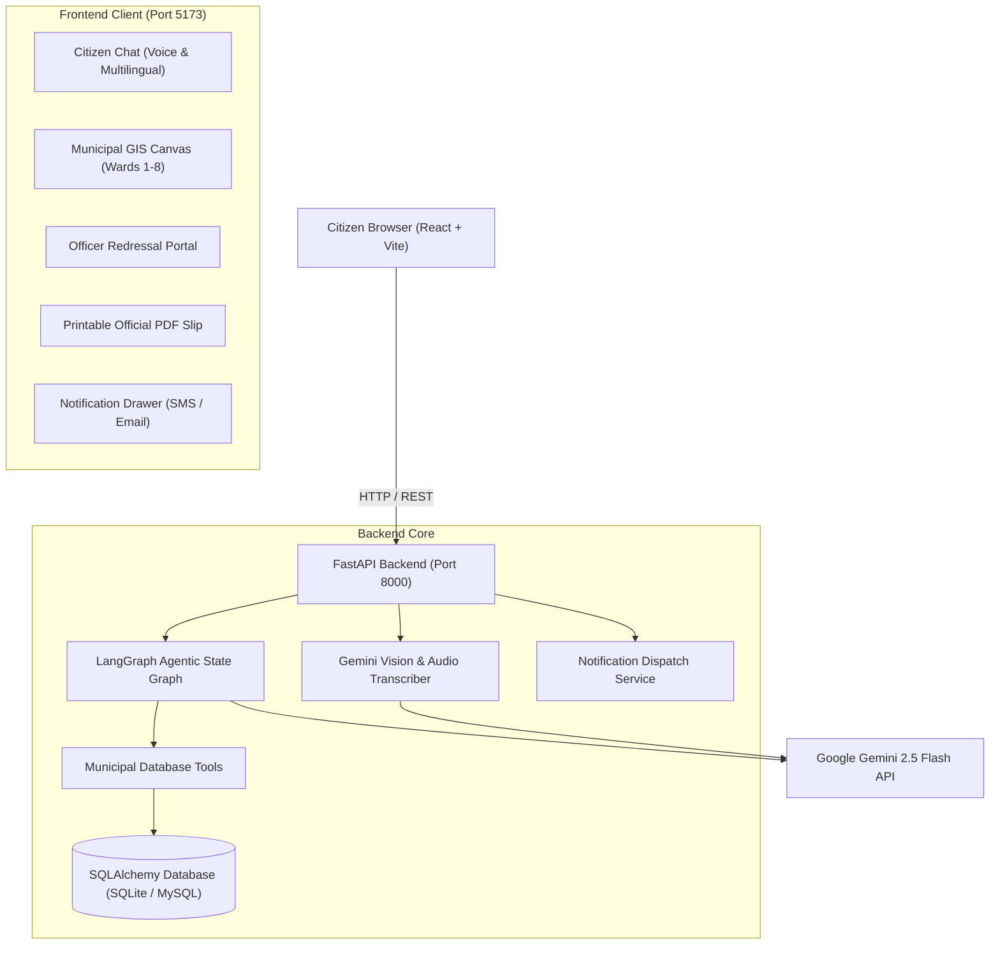

# 🏛️ Agentic AI Citizen Assistant (CitizenConnect AI)

> An enterprise-grade, end-to-end full-stack civic redressal platform powered by **Google Gemini 2.5 Flash**, **LangChain**, **LangGraph**, **FastAPI**, **React 18 (Vite)**, and an interactive **Municipal GIS Engine**.

---

## 🌟 Key Features

### 1. 🤖 Agentic AI Municipal Engine (LangGraph + Gemini)
* **Autonomous Civic Routing**: Uses LangGraph state graphs with tool calling to look up citizens, search municipal schemes, check ticket statuses, and register grievances autonomously.
* **Dual Database Resilience**: Native support for SQLite (`citizen_assistant.db`) and production MySQL via SQLAlchemy ORM with auto-migrations.

### 2. 🎙️ Dual-Engine Voice Dictation
* **Engine 1 (Native WebSpeech)**: Continuous voice recognition (`SpeechRecognition`) with real-time word streaming in supported Chromium environments.
* **Engine 2 (Gemini Audio AI Transcriber)**: Fallback powered by HTML5 `MediaRecorder` + Gemini Multimodal Audio that works across restricted networks, VPNs, and Brave browser shields.
* **Generous Silence Tolerance**: Continuous listening with live duration timers (`00:15`) and manual `[Done Speaking]` control.

### 3. 🌐 Multilingual Civic Translation (7 Languages)
* Supports **English**, **हिन्दी (Hindi)**, **Español (Spanish)**, **Français (French)**, **বাংলা (Bengali)**, **मराठी (Marathi)**, and **తెలుగు (Telugu)**.
* Dynamic language routing plumbed into FastAPI and LangGraph system prompts.

### 4. 📸 Gemini Multimodal Photo Severity Inspector
* Attach damage photos (potholes, water leaks, open garbage, broken streetlights).
* Gemini Vision analyzes severity (`Urgent`, `High`, `Moderate`, `Low`), classifies the responsible municipal department, and provides a 1-click **"Auto-fill Diagnosis into Complaint"** button.

### 5. 🗺️ Interactive Municipal GIS & Grievance Map
* Live coordinates plotted across **Wards 1 through 8**.
* Interactive **Pin-Drop Complaint Filing**: click anywhere on the city map to capture latitude and longitude and file an incident at that exact spot.
* Synchronized refresh indicator with live timestamps and active spinning animations.

### 6. 👔 Municipal Officer (Admin) Resolution Portal
* Dual-column administration console for city engineers and municipal officers.
* Queue filtering (`Pending`, `In Progress`, `Resolved`), official notes editor, and live status transitions.
* **Automated Citizen Dispatch**: Updating a ticket triggers immediate real-time SMS & Email dispatch logs.

### 7. 📄 Printable Official Municipal Grievance Slip
* Civic seal & crest header, unique ticket number, barcode / QR placeholder, GPS coordinates, and officer notes.
* Integrated print stylesheets with 1-click **"Print / Save as PDF"** via `window.print()`.

### 8. 🔔 Civic Dispatch Center & Notification Drawer
* Real-time SMS and Email notification logs with channel filtering.
* Persistent read/viewed state tracking with auto-clearing unread badge counters.

### 9. 🌓 Seamless Theme Switcher
* Custom-crafted Light and Dark mode variables persisted in `localStorage`.

---

## 🏗️ System Architecture



---

## 🚀 Quick Start Guide

### 1. Prerequisites
* Python 3.10+
* Node.js 18+
* Google Gemini API Key

### 2. Backend Setup
```powershell
# Navigate to backend directory
cd backend

# Create and activate virtual environment
python -m venv venv
.\venv\Scripts\activate

# Install dependencies
pip install -r requirements.txt

# Configure your Gemini API key in backend/.env:
# GEMINI_API_KEY=your_actual_key_here

# Seed initial citizens, schemes, and grievances
python seed_data.py

# Start FastAPI server
uvicorn main:app --reload --host 127.0.0.1 --port 8000
```

### 3. Frontend Setup
```powershell
# Navigate to frontend directory
cd frontend

# Install dependencies
npm install

# Start Vite dev server
npm run dev
```

Open your browser at **`http://localhost:5173`**.

---

## 📡 API Endpoints Overview

| Method | Endpoint | Description |
| :--- | :--- | :--- |
| `POST` | `/api/v1/chat/` | Conversational LangGraph agent query with language context |
| `GET` | `/api/v1/grievances/` | List all filed municipal grievances |
| `GET` | `/api/v1/grievances/map/pins` | Fetch geocoded coordinate pins for municipal map |
| `PATCH` | `/api/v1/grievances/{ticket}/status` | Officer status update + automated SMS/Email dispatch |
| `POST` | `/api/v1/upload/base64` | Upload civic photo evidence or documents |
| `POST` | `/api/v1/upload/analyze-evidence` | Gemini Vision analysis (severity & department diagnosis) |
| `POST` | `/api/v1/upload/transcribe-voice` | Gemini Multimodal Audio transcription (network fallback) |
| `GET` | `/api/v1/notifications/` | Dispatched SMS and Email alert logs |
| `GET` | `/api/v1/services/` | Municipal subsidy schemes and welfare benefits |
| `GET` | `/api/v1/health/` | End-to-end database, server, and Gemini health checks |

---

## 📄 License
MIT License. Built for smart municipal public governance.
